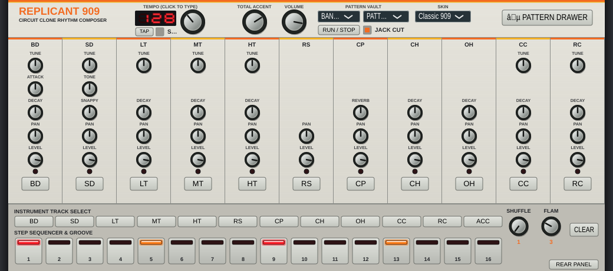
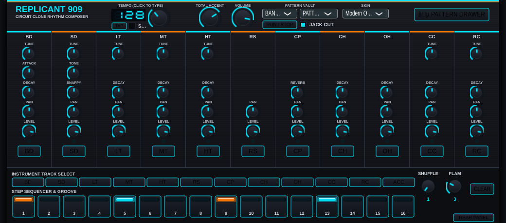
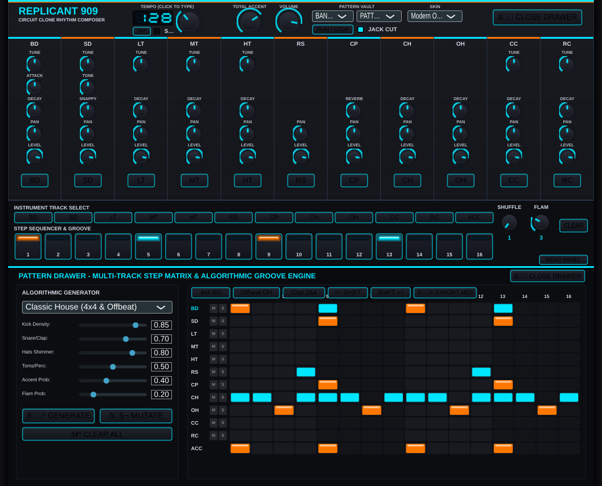

# 🥁 Replicant909

> **Circuit-Accurate 1:1 Roland TR-909 Emulation Plug-in & Standalone Drum Machine**  
> Formats: **VST3**, **CLAP**, **AU (Component)**, and **Standalone** | Multiplatform: **macOS (Universal arm64/x86_64)**, **Linux (x86_64)**, **Windows (x64)**.

---



## ⚡ Overview

**Replicant909** is a virtual analog and hybrid digital drum machine modeled down to the component-level circuit topology of the legendary **Roland TR-909 Rhythm Composer** (1983).

Based on the engineering and architectural foundation of **Replicant303**, Replicant909 combines:
1. **Discrete analog voice modeling** (bridged-T resonators, triangle VCOs, diode waveshapers, and multi-burst pulse envelopes) modeled from the original **Voicing Board PCB (2291084903)**.
2. **6-bit compressed PCM ROM playback** with authentic variable-clock sample rate counters, non-linear DAC companding, analog reconstruction filtering, and hardware choke circuitry.
3. **Multi-bus individual audio routing**: 10 dedicated individual drum outputs plus a master stereo bus, with optional mechanical jack auto-cut emulation.
4. **Dual procedural skins**: Toggle between the **Retro-Futuristic Classic** (vintage Roland ivory metal, orange/yellow striping, and 7-segment red LED) and **Modern Obsidian** (stealth matte carbon, electric neon cyan/amber illumination, knurled dials with halo meters, and OLED display).
5. **Authentic 909 Groove Sequencer**: 6-stage hardware shuffle/swing engine, programmable flams, internal clock/host sync, and Standard MIDI File (`.mid`) preset vault.

---

## 🔬 Circuit Architecture & Voice Modeling

The TR-909 was Roland's first hybrid analog/digital drum machine. Replicant909 implements mathematical continuous-time models of every discrete subsystem:

| Voice | Synthesis Method | Circuit Topology & Key Controls |
| :--- | :--- | :--- |
| **Bass Drum (BD)** | Discrete Analog | Triangle VCO swept by a dual-slope exponential pitch drop (280 Hz down to 42–75 Hz). Passed through a diode-transistor soft waveshaper that rounds peaks into a punchy sine with rich odd harmonics. Attack knob controls a dedicated pulse + filtered white noise click generator. Decay knob adjusts VCA capacitor discharge (0.15s–1.1s). Accent dynamically expands the initial chirp depth. |
| **Snare Drum (SD)** | Discrete Analog | Dual bridged-T active resonators (tuned to ~185 Hz and ~340 Hz) providing shell body. Tune knob shifts both modes. Snappy knob controls a discrete transistor white noise generator gated by a dual-decay envelope (fast crack + tail rattle). Tone knob controls the balance and high-pass filter cutoff. |
| **Low Tom (LT)** | Discrete Analog | Bridged-T resonator centered at 75–130 Hz. Initial pitch drop mimics acoustic skin tension release upon stick impact. Decay knob controls the damping feedback resistor. |
| **Mid Tom (MT)** | Discrete Analog | Bridged-T resonator centered at 110–195 Hz with downward pitch chirp and stick click transient. |
| **Hi Tom (HT)** | Discrete Analog | Bridged-T resonator centered at 160–280 Hz with downward pitch chirp and stick click transient. |
| **Rim Shot (RS)** | Discrete Analog | Modal pulse circuit exciting 3 parallel ringing bandpass filters tuned to 250 Hz, 495 Hz, and 1580 Hz. Produces the iconic hollow wooden snap and metallic resonance. |
| **Hand Clap (CP)** | Discrete Analog | Transistor white noise passed through a 1180 Hz bandpass filter (Q ~ 1.8). 4-event envelope generator: 3 micro-bursts spaced by 10 ms (simulating hands clapping together), followed by the main slap and an exponential room reverb tail. Reverb knob adjusts tail decay from 80 ms to 600 ms. |
| **Closed Hi-Hat (CH)** | Hybrid 6-Bit PCM | Recorded Paiste Formula 602 Sound Edge 14" cymbals digitized at 6-bit resolution (64 discrete levels) at 32 kHz. Analog BA662 VCA envelope provides tight decay (30 ms–120 ms). Active analog reconstruction filter removes DAC imaging while preserving sizzle. |
| **Open Hi-Hat (OH)** | Hybrid 6-Bit PCM | Stored in the same 6-bit PCM ROM bank with longer sustain (150 ms–850 ms). **Hardware Choke Circuit:** Triggering a Closed Hi-Hat immediately discharges the Open Hi-Hat envelope capacitor in ~3 ms. |
| **Crash Cymbal (CC)**| Hybrid 6-Bit PCM | 32 KB mask ROM playback of a 18" Paiste Formula 602 Thin Crash. Front panel **Tune** knob varies the master clock oscillator (+/- 1 octave around 32 kHz). Analog decay envelope (0.6s–3.5s). |
| **Ride Cymbal (RC)** | Hybrid 6-Bit PCM | 32 KB mask ROM playback of a 20" Paiste Formula 602 Medium Ride with prominent 2840 Hz bell ping. Tunable sample clock and analog VCA decay. |
| **Total Accent** | Analog Voltage Bus | Central accent bus that scales the trigger impulse voltage and VCA bias for accented steps, altering transient bite and volume across all instruments simultaneously. |

---

## 🎨 Dual Front-Panel Skins

Replicant909 features a procedural, resolution-independent vector rendering engine that supports real-time skin switching with persistent state:

### 1. Retro-Futuristic Classic (Authentic TR-909)

* Vintage Roland ivory/cream painted metal chassis with subtle horizontal grain.
* Charcoal-grey side cheeks (`#2d2f34`).
* Authentic Roland orange (`#f36b21`) and yellow (`#f4b025`) racing stripes and silkscreen channel lines.
* Beveled rectangular step buttons with dual-state amber/red LED windows.
* 3-digit 7-segment red LED tempo display in a recessed smoked-acrylic chamber.
* Spun aluminum knob caps with dark fluted outer skirts.

### 2. Modern Obsidian (Cyberpunk Stealth)

* Deep matte carbon chassis (`#181a20`) with dark gunmetal beveling.
* Electric neon cyan (`#00e5ff`) and amber (`#ffff7700`) accent illumination.
* Modern knurled rotary dials with glowing radial arc value indicators.
* High-contrast electric cyan OLED digital display.
* Backlit silicone keys with neon halo borders.

---

## ☵ Sliding Pattern Drawer & Algorithmic Generator


Click the **☵ PATTERN DRAWER** button in the header bar to reveal the full-height slide-out programming workstation:

1. **Algorithmic Procedural Generator**:
   * **7 Curated Musical Styles**:
     * *Classic House* (4-on-the-floor kick, offbeat open hat, clap on 2 & 4, syncopated rimshots, 54.2% swing)
     * *Detroit Driving Techno* (heavy kick, ride cymbal 8ths, tuned toms groove)
     * *Acid Jack & Warehouse* (aggressive kick, accented rimshots, 16th hats, 58.3% swing)
     * *Hard Techno & Rave* (relentless kick, snare flams, crash on downbeats)
     * *Electro Funk Breakbeat* (syncopated broken kicks, 62.5% swing)
     * *Minimal Click & Microhouse* (sparse, organic micro-percussion)
     * *Algorithmic Cyber Chaos* (stochastic multi-voice distribution)
   * **Density & Probability Sliders**: Kick Density, Snare/Clap, Hats Shimmer, Toms/Perc, Accent Probability, Flam Probability.
   * **Action Buttons**: `🎲 GENERATE`, `🧬 MUTATE` (20% intelligent variation), and `↺ CLEAR ALL`.

2. **12-Track x 16-Step Matrix Programmer**:
   * Simultaneous overview of all 11 drum voices plus the global ACCENT track.
   * **Per-Track Mute [M] & Solo [S]** buttons with real-time audio muting.
   * **Dual-State & Tri-State Cell Toggling**: Off, Normal Hit, Accent (core highlight), and Flam (split trigger line).
   * **Real-Time Running Playhead**: Sweeping vertical cursor tracking playback across all 12 lanes.
   * **Quick Pattern Tools**: `4x4 BD`, `Offbeat OH`, `Clap 2&4`, `<< SHIFT`, `SHIFT >>`, and `💾 EXPORT MIDI`.

---

## ⏱️ Direct Editable Tempo Display
* **Direct Numeric Typing**: Click directly on the 7-segment digital tempo readout to type any BPM (30 to 300) from the keyboard and press Enter.
* **Vertical Nudge Drag**: Drag up or down on the digits to smoothly dial in the tempo.
* **Rotary Dial & Tap Tempo**: Traditional rotary dragging and authentic hardware TAP tempo button are simultaneously supported and synchronized.

---

## 🔌 Multi-Bus Audio Routing & Rear Panel

In addition to the Master Stereo Bus (Out 1-2), Replicant909 provides **10 Individual Audio Buses**:

1. **Bass Drum Out**
2. **Snare Drum Out**
3. **Low Tom Out**
4. **Mid Tom Out**
5. **Hi Tom Out**
6. **Rim Shot Out**
7. **Hand Clap Out**
8. **Hi-Hat Out** *(Shared by CH and OH, exactly as in physical hardware)*
9. **Crash Cymbal Out**
10. **Ride Cymbal Out**

### Virtual Rear Panel & Jack Auto-Cut Mode
* Click the **REAR PANEL** button to reveal the virtual 1/4" phone jacks and MIDI DIN-5 ports.
* **Jack Cut Mode**: When enabled, activating an individual output in your DAW automatically removes that instrument from the Master Stereo Bus, mimicking the physical switching contact inside hardware 1/4" phone jacks. When disabled, the instrument feeds both its individual stem bus and the master mix.

---

## 🎛️ 909 Groove Sequencer & Shuffle Engine

* **16-Step Dual-State Sequencer**: Off, Normal Hit, Accented Hit (bright red LED), and Flam (yellow LED).
* **Authentic TR-909 Hardware Shuffle**: 6 switchable groove positions delaying even 16th steps:
  * **1**: 50.0% (Straight 16th notes)
  * **2**: 54.2%
  * **3**: 58.3%
  * **4**: 62.5%
  * **5**: 66.7% (Triplet swing)
  * **6**: 70.8% (Heavy funk shuffle)
* **Flam Engine**: Selectable flam interval (1 to 8 sub-clock ticks, 10 ms to 45 ms) producing an authentic pre-strike ghost note followed by an accented slam.
* **Clock Sync**: Internal clock (30–300 BPM) with Tap Tempo, or instant lock to DAW host transport.
* **Pattern Vault**: 32 patterns organized across Bank A (1-16) and Bank B (1-16).

---

## 🗄️ Standard MIDI File (.mid) Preset Vault

Every preset in Replicant909 is exportable and importable as a **Standard MIDI File (`.mid`)**.

* When exported, it generates a standard Type 0 MIDI file that plays in any DAW or sampler.
* The file embeds the full Replicant909 synthesizer patch parameters in a metadata header. Dragging the `.mid` back into Replicant909 instantly restores the complete kit parameters, pattern, and groove settings!
* Standard GM/TR-909 note mappings:
  * **BD**: 35, 36
  * **SD**: 38, 40
  * **RS**: 37
  * **CP**: 39
  * **CH**: 42, 44
  * **OH**: 46
  * **LT**: 41, 43
  * **MT**: 45, 47
  * **HT**: 48, 50
  * **CC**: 49
  * **RC**: 51

---

## 🛠️ Building & Compilation

Replicant909 uses **CMake (>= 3.22)** and **JUCE 8**, with automated fetching of `clap-juce-extensions`.

### Prerequisites

#### Linux (Ubuntu/Debian)
```bash
sudo apt-get update && sudo apt-get install -y \
  build-essential cmake git \
  libasound2-dev libjack-jackd2-dev ladspa-sdk \
  libfreetype6-dev libx11-dev libxcomposite-dev \
  libxcursor-dev libxext-dev libxinerama-dev \
  libxrandr-dev libxrender-dev mesa-common-dev \
  libgl1-mesa-dev libgtk-3-dev xvfb
```

#### macOS
* Xcode 15 or later with Command Line Tools.

#### Windows
* Visual Studio 2022 with C++ desktop workload and CMake.

---

### Build Instructions

```bash
# Clone the repository
git clone https://github.com/DanimanX/Replicant909.git
cd Replicant909

# Configure with CMake
cmake -B build -DCMAKE_BUILD_TYPE=Release

# Build all targets (VST3, CLAP, Standalone, AU on macOS)
cmake --build build --config Release --parallel

# Run headless test suite
./build/run_tests
```

---

## 🧪 Test Suite & Offscreen Snapshot Generator

* **`run_tests`**: Headless regression test verifying voice synthesis RMS, choke timing, accent dynamics, multi-bus routing, sequencer swing, and MIDI round-trip.
* **`generate_snapshot`**: Headless offscreen renderer that renders pixel-perfect PNG previews of both Classic and Modern skins directly from the UI engine.

---

## 📄 License

Distributed under the **MIT License**. See [`LICENSE`](LICENSE) for details.

Developed with passion by **DanimanX**.
